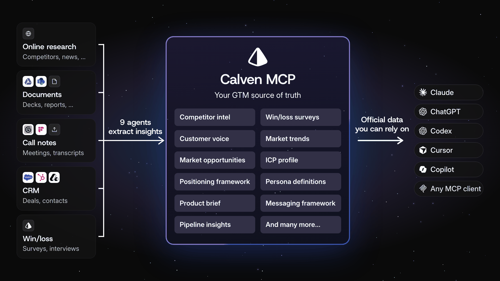

<p align="center">
  <a href="https://calven.ai/mcp">
    <picture>
      <source media="(prefers-color-scheme: dark)" srcset="docs/assets/symbol-white.svg">
      
    </picture>
  </a>
</p>

<h1 align="center">Calven MCP</h1>

<p align="center">Your approved GTM context, in every AI tool: positioning, messaging, ICP, personas, competitive intel and win/loss, with sources.</p>

<p align="center">
  <a href="#connect">Connect</a> · <a href="#try-it">Try it</a> · <a href="use-cases/">Use cases by team</a> · <a href="https://calven.ai/mcp">calven.ai/mcp</a> · <a href="https://app.calven.ai/sign-up">14-day trial, no card</a>
</p>

<p align="center">
  <a href="https://registry.modelcontextprotocol.io/?q=ai.calven"></a>
  <a href="LICENSE"></a>
</p>

<p align="center">
  
</p>

Calven is the AI product marketing platform. Its nine agents keep one GTM source of truth on your market, buyers, positioning and messaging. Calven MCP puts it inside Claude, ChatGPT, Codex, Cursor, Copilot and other MCP clients that sign in with OAuth (see [client support](docs/client-support.md)), so sales, marketing, product and leadership work from the same answers your team approved. The plugin adds workflows for battlecards, deal prep, quality reviews, on-message drafts, customer evidence, ICP checks, market research, product intelligence, and live win/loss and ICP pipeline dashboards.

## Connect

Paste this URL where your client asks for an MCP server, choose **OAuth** if asked, and sign in to Calven:

```text
https://api.calven.ai/mcp
```

You need a Calven workspace ([14-day trial, no card](https://app.calven.ai/sign-up)). Using another client? See [client support](docs/client-support.md).

<details>
<summary><b>Claude</b> (claude.ai, desktop)</summary>

**Customize → Connectors → Add custom connector**, paste the URL (name it `Calven` if asked), **Add**, then **Connect** and sign in to Calven. If the dialog asks how Claude identifies itself, choose **Use Claude's published identity**; automatic (dynamic) registration does not work with Calven. In a chat, turn Calven on under **+ → Connectors**.

On Team and Enterprise plans, an Owner adds the connector once: **Organization settings → Connectors → Add → Custom → Web**, paste the URL, **Add**. Each member then opens **Customize → Connectors**, finds Calven with the **Custom** label, and clicks **Connect**.

</details>

<details>
<summary><b>ChatGPT</b></summary>

Open **Plugins** in ChatGPT (`chatgpt.com/plugins`), select the plus button, then **Add custom MCP server**. Name it `Calven`, enter the URL as the **Server URL**, choose **OAuth**, accept the risk warning and select **Create as a plugin**. Install Calven from your personal plugins, then type `@` in a chat and select it. Your plan and workspace settings decide whether you can add custom MCP servers; see OpenAI's [Add custom MCP server](https://developers.openai.com/api/docs/guides/custom-mcp-server) guide.

</details>

<details>
<summary><b>Cursor</b></summary>

[](https://cursor.com/install-mcp?name=calven&config=eyJ1cmwiOiJodHRwczovL2FwaS5jYWx2ZW4uYWkvbWNwIn0%3D)

Or add this to `~/.cursor/mcp.json`:

```json
{ "mcpServers": { "calven": { "url": "https://api.calven.ai/mcp" } } }
```

</details>

<details>
<summary><b>VS Code and GitHub Copilot</b></summary>

[](https://vscode.dev/redirect/mcp/install?name=calven&config=%7B%22type%22%3A%22http%22%2C%22url%22%3A%22https%3A%2F%2Fapi.calven.ai%2Fmcp%22%7D)

Or command palette → **MCP: Add Server** → **HTTP**, paste the URL, name it `calven`.

</details>

<details>
<summary><b>Claude Code and Codex</b></summary>

Register the server, then sign in. Each `login` opens your browser for the Calven sign-in.

```sh
claude mcp add --transport http calven https://api.calven.ai/mcp
claude mcp login calven

codex mcp add calven --url https://api.calven.ai/mcp
codex mcp login calven
```

Inside a Claude Code session, you can instead run `/mcp`, select `calven` and follow the browser sign-in.

</details>

## Try it

**Sales:** walk into every deal knowing how you win it.

```text
Why did we lose our last three deals to Acme? Quote the buyers, then give me the first question to ask on my next call against them.
```

**Marketing:** campaigns in the buyer's words.

```text
Draft three ad headlines for Heads of Data in our customers' own words, then tell me which one our personas would pick.
```

**BDRs:** outreach tested on the buyer before it's sent.

```text
Would our buyer persona reply to this email? If not, rewrite it in our customers' words. [paste email]
```

**Product:** build what wins deals.

```text
Which product gaps cost us deals this year? Rank them by deals lost and quote the buyers.
```

**Leadership:** win rate you can trust.

```text
What is our win rate by competitor this year versus last, and why do we win and lose? Cite n.
```

**Anyone:** no unsupported claims.

```text
Check every product, pricing and competitor claim in this draft against our approved product brief and battlecards. [paste draft]
```

190 use cases for 19 teams, each with ready-to-paste prompts, in [use-cases/](use-cases/).

## What it reads, and what it won't do

Your assistant reads, with sources: positioning, messaging, ICP and product brief; competitor dossiers and battlecards; personas; calls, customer quotes and win/loss; market trends; Insights dashboards; and CRM accounts and deals where your workspace allows it.

- **Results carry their sources.** An empty result says nothing is recorded. Calven does no web search, and its server instructions tell the model not to fill gaps from its own knowledge.
- **Thirteen read tools and one review action**, listed in the [tool catalog](docs/tool-catalog.md), plus four server prompts. The action, `review_against_personas`, starts a review task in Calven and returns findings. No tool edits your workspace content, and nothing is published or sent.
- **Your permissions.** Each user signs in as themselves and sees only what their Calven role allows. Admins decide whether transcripts and pipeline are readable over MCP. Removing a user removes their MCP access.

> [!IMPORTANT]
> Answers contain your company's confidential data. Use an AI client and model provider your organization has approved. See [data handling](docs/data-handling.md).

Data is stored in the EU, a DPA with EU SCCs covers every plan, and the SOC 2 Type I audit is in progress. Details on the [Trust Center](https://trust.calven.ai).

## The plugin

The Calven plugin bundles the server connection with thirteen workflow skills and a research subagent. Install it in Claude Code:

```sh
claude plugin marketplace add calven-ai/calven-mcp
claude plugin install calven@calven
```

Then run `/calven:start` to check the connection and get three first prompts built from your workspace.

| Type | Name | What you get |
| --- | --- | --- |
| Skill | `/calven:battlecard` | Where you win and lose against a named competitor: objections, proof and a talk track |
| Skill | `/calven:deal-prep` | A one-page call brief: buying group, the competitor's likely moves, the risk, the first question, the proof |
| Skill | `/calven:quality-review` | An asset reviewed before it ships: every claim checked, on-message fit, what a product change left stale, and a persona review |
| Skill | `/calven:persona-copy-review` | Your copy reviewed against your personas, findings by severity |
| Skill | `/calven:on-message-draft` | Copy written from your approved messaging, accuracy-checked and persona-tested before you get it |
| Skill | `/calven:customer-evidence` | Verbatim customer quotes, themes and proof points on a topic, each with its source |
| Skill | `/calven:icp-check` | A list of accounts checked against your ICP: fit, partial or no fit, and why |
| Skill | `/calven:icp-pipeline-review` | A live dashboard of how much of your pipeline and wins fit the ICP, and where to focus |
| Skill | `/calven:win-loss-review` | A live win/loss dashboard for a month or quarter, every rate with its sample size |
| Skill | `/calven:market-research` | A sourced market briefing: trends, opportunities, growing verticals and the latest signals |
| Skill | `/calven:product-intelligence` | What changed in your product and which published assets now contradict it |
| Skill | `/calven:gtm-overview` | A sourced summary of your positioning, messaging, ICP and evidence |
| Skill | `/calven:start` | Connection check and what your workspace can answer (runs only when you type it) |
| Subagent | `gtm-researcher` | Gathers evidence from several Calven sources and keeps large results out of your conversation |

Skills load on their own when a request matches, except `start`, which runs only when typed; you can type any of them. The two dashboard skills publish a live page that reads Calven each time it opens: an artifact in Claude, a Site in ChatGPT. Cursor installs it from its own manifest, and clients that implement [Agent Plugins](https://agent-plugins.org/) can import the skills and the server connection. Contents, formats and how the workflows are tested: [plugin](docs/plugin.md).

## Help

[calven.ai/mcp](https://calven.ai/mcp) · [Troubleshooting](docs/troubleshooting.md) · [Open a connection issue](https://github.com/calven-ai/calven-mcp/issues/new/choose) · support@calven.ai

This repository is the public distribution surface for Calven's hosted MCP server; the server source is private. Manifests, validation and contribution rules are in [docs/](docs/) and [CONTRIBUTING.md](CONTRIBUTING.md). Report security issues through [SECURITY.md](SECURITY.md).

<p align="center"><sub>This repository is MIT licensed; the Calven service is not · <a href="https://calven.ai/privacy">Privacy</a> · <a href="https://calven.ai/terms">Terms</a></sub></p>
